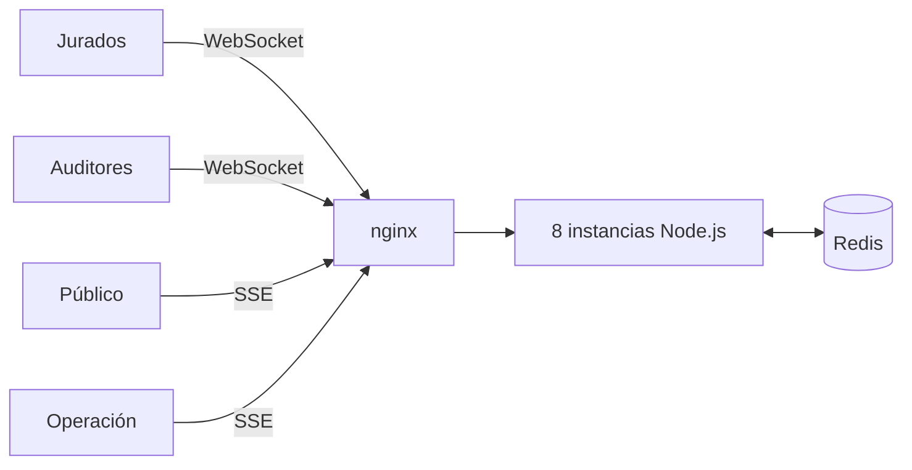

# 🗳️ Preconteo electoral en tiempo real

Sistema que recibe las actas E-14 de los jurados, envía las dudosas a verificación humana y muestra los resultados en vivo al público.

Taller de WebSockets · Programación Orientada a la Web · Séptimo semestre

**🌐 Demo en vivo:** http://3.141.105.188/

## 🔗 Páginas

| Página | URL | Para quién | Qué se hace ahí | Acceso |
|---|---|---|---|---|
| 📊 Resultados | http://3.141.105.188/ | Público | Ver resultados en vivo y filtrar por municipio o puesto | Libre |
| ✍️ Jurados | http://3.141.105.188/jurado | Jurados | Transmitir y corregir actas, incluso con mala señal | Credencial `JUR-12345` (3 a 8 dígitos) |
| 🔎 Verificación | http://3.141.105.188/auditor | Auditores | Tomar, aprobar o rechazar actas que no cuadran | Credencial de auditor |
| 📈 Operación | http://3.141.105.188/ops | Equipo técnico | Ver instancias, cola de verificación y retraso del Event Loop | Credencial de operación |

> Las credenciales de auditor y de operación se entregan por privado.

## 🎬 Pruébalo en 2 minutos

1. Abre **Resultados** en una pestaña y **Jurados** en otra.
2. En Jurados, escribe una mesa (1 a 6.400), pulsa **Llenar con datos de prueba** y luego **Transmitir acta**. A los pocos segundos cambia Resultados.
3. Transmite otra mesa, pero cambia el total de sufragantes para que no cuadre. El acta pasa a verificación y no se suma.
4. En **Verificación**, toma el caso y apruébalo. Ahora sí aparece en Resultados.
5. En Jurados, pulsa **Corregir esta acta** en una ya registrada. Resultados explica el cambio en "Cambios explicados".

## 🏗️ Cómo funciona



- **Sin sesiones pegajosas:** cualquier instancia atiende a cualquier cliente, y todo lo compartido vive en Redis.
- **Sin votos dobles:** `apply_acta.lua` aplica cada acta en una sola operación atómica, con clave de idempotencia y control de versión.
- **Sin saturar al público:** un agregador líder publica un solo cambio por ventana de tiempo en un Redis Stream.
- **Sin perder actas:** la app guarda cada acta en el dispositivo y la reenvía con la misma clave hasta recibir respuesta definitiva.
- **Reconexión sin huecos:** el público recupera lo que se perdió desde el Stream o recibe una fotografía completa.

## 🔌 Endpoints

| Ruta | Tipo | Uso |
|---|---|---|
| `/ws/jurado?jurado=JUR-12345` | WebSocket | Envío de actas y confirmación de cada una |
| `/ws/auditor` | WebSocket | Cola, reservas, aprobación y rechazo |
| `/sse/public?view=dep` | SSE | Resultados en vivo |
| `/api/snapshot?view=dep` | GET | Fotografía de resultados, usada como respaldo |
| `/api/geo` | GET | Municipios, puestos y candidatos |
| `/api/inp` | POST | Medición de INP del público |
| `/api/ops`, `/sse/ops` | GET / SSE | Métricas (requieren token de operación) |
| `/api/debug/flood` | POST | Demostración de cliente lento (solo con `DEMO_MODE=1`) |
| `/healthz` | GET | Salud de la instancia: 200 normal, 503 sin Redis |

## 👥 Qué hizo cada quien

### Juan Felipe Mora · Ingesta de actas
**RF-1, RF-2, RF-3, RF-10 (Redis caído), RT-6**
- Arranque del proyecto, mapa de 1.842 puestos y 6.400 mesas, y configuración.
- Conexiones a Redis y `apply_acta.lua`: idempotencia, correcciones fuera de orden y acumulados en cuatro niveles.
- Validación de actas, regla contable y límite de envíos por credencial.
- Gateway WebSocket de jurados y modo degradado cuando Redis cae.
- App del jurado con cola local y reenvío automático.
- Prueba e2e, simulador de jurados e integración final de las tres ramas.

### Luis Cajigas · Fan-out y público
**RF-4, RF-5, RF-6, RF-9, RF-10 (avalancha), RT-4, RT-8, RT-9**
- Agregador con líder único y publicación por ventanas en Redis Stream.
- Suscripción por tópicos y envío por lotes sin bloquear el Event Loop.
- Gateway SSE con recuperación por historial o fotografía.
- Contrapresión para clientes lentos y polling de respaldo.
- Página de resultados con reconexión con jitter, correcciones explicadas y medición de INP.
- Simuladores de miles de clientes y de cliente lento.

### Sara · Verificación e infraestructura
**RF-7, RF-8, RT-1, RT-2, RT-3, RT-5, RT-7, RT-10**
- Cola por prioridad y bloqueos distribuidos con token de dueño.
- Presencia de auditores y devolución de casos expirados.
- Gateway de auditores, consola de verificación y tablero de operación.
- Métricas por instancia publicadas en Redis.
- Docker, Compose con 8 réplicas, nginx sin afinidad y clúster local.
- Simulador de auditores y pruebas de integración con Redis real.

## 🚀 Ejecutarlo en local

Con Docker:

```powershell
Copy-Item .env.example .env
docker compose up -d --build
```

Abre http://localhost:8080. Credenciales de ejemplo: auditor `sara-local`, operación `ops-local`.

Sin Docker (requiere Node 22.9+ y Redis 7):

```powershell
npm ci
Copy-Item .env.example .env
npm run cluster:local
```

> Cambia las credenciales de `.env.example` antes de exponer el sistema a internet.

## ✅ Pruebas

Con el sistema corriendo en `localhost:8080`:

```powershell
$env:BASE_A='http://localhost:8080'
$env:BASE_B='http://localhost:8080'
npm test
npm run check:deployment
```

Las pruebas de verificación necesitan un Redis aparte:

```powershell
docker run -d --name redis-test -p 127.0.0.1:6389:6379 redis:7.4-alpine
$env:TEST_REDIS_URL='redis://127.0.0.1:6389'
npm run test:integration
docker rm -f redis-test
```

Simuladores de carga: `npm run load:jurors`, `load:public`, `load:slow` y `load:auditors`.

## ☁️ Despliegue actual

- AWS EC2 `t3.micro` con Ubuntu, 8 réplicas, Redis y nginx en Docker Compose.
- Funciona por HTTP, sin dominio ni certificado.
- La máquina alcanza para la demo, no para pruebas de carga pesadas.

## 🚧 Pendiente

- Pruebas de carga y mediciones en la nube (secciones 9 y 10 del informe).
- Mostrar en `/ops` las actas por minuto, los mensajes emitidos contra ingenuos y el INP.
- Automatizar el despliegue con GitHub Actions.
- Agregar HTTPS y una IP fija.

## 📚 Más información

- [Informe de arquitectura](docs/ARQUITECTURA.md)
- [Contratos de integración](docs/INTEGRACION.md)
