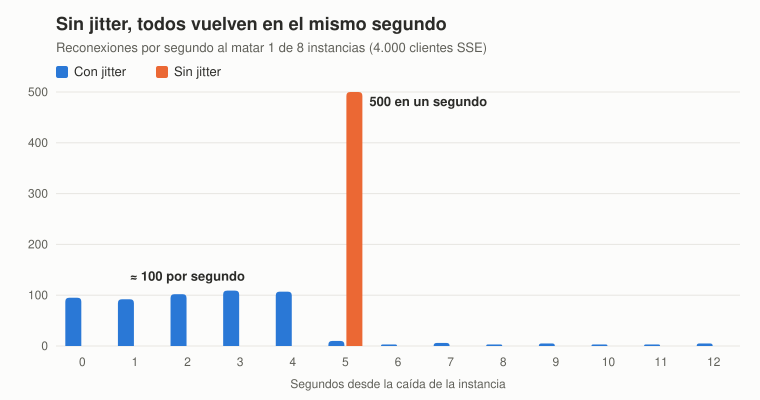

# Informe de arquitectura — Preconteo en tiempo real

Taller de WebSockets · Programación Orientada a la Web · Séptimo semestre
Grupo: Juan Felipe · Juan Cajigas · Sara

> Las cifras marcadas como **medido** salen de ejecuciones reales del repositorio (clúster local de 8 instancias + Redis 7). Antes de la sustentación hay que repetirlas contra el despliegue en la nube y reemplazarlas en la tabla de la sección 7.

---

## 2. Flujo de un acta

1. El jurado digita el acta; la app la **persiste en localStorage** antes de enviarla (RT-6).
2. Viaja por WebSocket con su `idem`. La instancia valida formato y regla contable.
3. `apply_acta.lua` hace, en una sola operación atómica: idempotencia → control de versión → reversión de la versión anterior → suma en mesa/puesto/municipio/departamento → conteo de mesas informadas → marca de tópicos sucios → registro de la corrección.
4. La instancia responde al jurado con un estado inequívoco (`APPLIED`, `CORRECTED`, `DUPLICATE`, `STALE`, `HELD`, `UNAVAILABLE`…).
5. Cada `TICK_MS` el líder ejecuta `flush_window.lua`: calcula el delta mínimo por tópico y hace `XADD`.
6. Las 8 instancias reciben la entrada y hacen fan-out por lotes a los grupos de vista afectados.

## 3. Requerimientos funcionales

### RF-1 · Idempotencia
- Clave `idem:<clave>` con la **respuesta original** serializada, `EX 6 h` (`IDEM_TTL_SEC`). Un reenvío recibe `DUPLICATE` + la respuesta original: el jurado sabe con certeza qué pasó.
- Segunda barrera independiente de la clave: la **versión** guardada en `acta:<id>`. Si la clave ya expiró y llega un reintento tardío, el script ve `version actual ≥ recibida` y responde `DUPLICATE_VERSION`/`STALE` sin sumar.
- **Caída entre registrar y confirmar:** el script es atómico, así que o se aplicó todo (incluida la clave) o nada. Si la instancia muere después del `EVALSHA` pero antes de enviar el ack, el jurado no recibe respuesta, su app reenvía a los 8 s con **la misma clave**, cae en otra instancia y recibe `DUPLICATE` con el resultado original. Nunca se suma dos veces ni se pierde.

### RF-2 · Correcciones y convergencia
- Regla: se aplica una versión solo si es **estrictamente mayor** que la aplicada. El estado final es `max(versión válida recibida)`, independiente del orden.
- La reversión usa los votos guardados de la versión anterior (`ZINCRBY -n`) y suma los nuevos, todo dentro del mismo script.
- Las correcciones se encolan en `corrections:pending`; el agregador las adjunta a la ventana y el público las ve en "Cambios explicados", con el diferencial por candidato. Así un número que baja **siempre** llega con su explicación.
- Una versión dudosa queda en `held:<id>` y no toca el acumulado hasta que un auditor la aprueba; si mientras tanto llega una versión válida mayor, la retenida queda obsoleta (`superseded`).

### RF-3 · Acumulados jerárquicos atómicos
- Totales en **ZSET** `tot:{mesa|puesto|mun|dep}` (miembro = opción, score = votos). Ranking sin recorrer nada: `ZREVRANGE tot:mun:11 0 -1 WITHSCORES` es O(log N + M) con M = 6 opciones.
- Mesas informadas en contadores `inf:*` (`INCR` solo la primera vez que una mesa reporta).
- **Por qué Lua y no varios comandos desde Node:** entre dos comandos enviados por la aplicación pueden ejecutarse comandos de otros clientes (otra instancia aplicando otra acta, un lector tomando la fotografía). Un `MULTI/EXEC` evita el intercalado pero no permite decidir con datos leídos dentro de la transacción (versión actual, votos previos). Redis ejecuta un script Lua **de principio a fin sin intercalar nada**, así que ningún lector ve el municipio actualizado y el puesto todavía no.
- Lectura también atómica: `snapshot.lua` lee lo publicado + el id del Stream en la misma operación.
- **Restricciones que impone Lua:** el script bloquea Redis mientras corre (debe ser corto: el nuestro es O(opciones)); no puede hacer I/O externo; en Redis Cluster todas las claves deben declararse en `KEYS` y vivir en el mismo slot (habría que usar hash tags como `{e}tot:dep`). `flush_window.lua` construye claves dentro del script, válido en un nodo con réplica.

### RF-4 · Fan-out sin bloquear el Event Loop
- `sendInBatches` envía `FANOUT_BATCH` (500) escrituras y cede con `setImmediate`, que deja correr la fase de I/O (incluidos los acks de jurados) antes del siguiente lote.
- El mensaje se serializa **una vez por grupo de vista** y se reutiliza para todos sus clientes.
- Retraso del Event Loop medido con `perf_hooks.monitorEventLoopDelay` (resolución 1 ms) y publicado cada segundo (p99, máx.).

**La trampa de escala.** Cifra ingenua: 6.400 actas × 400.000 clientes = 2.560 millones de mensajes, y en el pico (≈ 5 actas/s) cada instancia tendría que hacer 5 × 50.000 = **250.000 escrituras/s**. Con agregación por ventana, cada cliente recibe **como máximo un mensaje por ventana**, sin importar cuántas actas entren:

| `TICK_MS` | Ventanas en 2 h | Máximo total | Escrituras/s por instancia en el pico |
|---|---|---|---|
| ingenuo | — | 2.560 M | 250.000 |
| 2.000 | 3.600 | ≤ 1.440 M | 25.000 |
| 5.000 | 1.440 | ≤ 576 M | 10.000 |

Lo que se vuelve insostenible en la estrategia ingenua es la **tasa en el pico**, y esa es la que queda acotada. El tablero muestra la cifra real emitida contra la ingenua. **Medido:** 800 actas en 1 minuto con 3.000 clientes → 3.109.210 mensajes ingenuos frente a 132.456 emitidos (23,5× menos). Además los clientes de un puesto o municipio solo reciben cuando su tópico cambia.

### RF-5 · Suscripción por tópico
- Vista = `dep` + municipio opcional + puesto opcional. Los clientes con la misma vista forman un **grupo** (`src/fanout/topics.js`):
  - `groups: Map<clave, {topics, clients: Set}>`
  - `topicIndex: Map<tópico, Set<clave de grupo>>`
- Alta O(1), baja O(1), recorrido O(grupos del tópico + clientes de esos grupos). Nunca se recorren las 50.000 conexiones para un cambio de un puesto.
- Un grupo recibe un único mensaje por ventana con el delta combinado de sus tópicos: así el id del evento SSE cubre toda la vista y la reconexión no puede perder un tópico.

### RF-6 · Reconexión con recuperación
- **Identificador:** el id de la entrada del Stream (`<ms>-<seq>`, monótono) es el `id:` del evento SSE. El navegador lo devuelve en `Last-Event-ID`; nuestro cliente lo manda en `?lastId=`.
- **Al reconectar** (`src/fanout/history.js`):
  - id dentro de la ventana retenida y ≤ 300 entradas atrás → `XRANGE (lastId +` filtrado a sus tópicos, fusionado en **un solo delta**.
  - id recortado, demasiado viejo o ausente → **fotografía** de lo publicado (`snapshot.lua`), con el id exacto al que corresponde.
- Durante la reproducción los mensajes en vivo se guardan en un búfer y se entregan después, descartando los ya cubiertos: no hay huecos ni duplicados.
- **Si Redis no responde al reconectar**, el cliente recibe el aviso y la instancia reintenta hasta poder ponerlo al día. No pasa al flujo en vivo antes: los deltas solo traen lo que cambió y, sin el estado base, mostraría cifras incompletas sin saberlo.
- **Por qué no Pub/Sub:** lo publicado mientras alguien está desconectado se pierde. El Stream conserva el historial.
- **Retención:** `XADD MAXLEN ~ 1000` → 1.000 ventanas ≈ 33 min a 2 s (cubre con creces los 30 s pedidos). **Medido:** ~4,8 KB por entrada en el pico → ≈ 4,7 MB para 1.000 entradas.

### RF-9 · Clientes lentos y contrapresión
- Se vigila `res.writableLength` de cada conexión.
- `> SSE_HIGH_WATER` (256 KB): el cliente queda **rezagado**; se deja de enviarle detalle. En el evento `drain` se le manda una **fotografía** y vuelve al flujo normal; lo que llegue mientras tanto se entrega después de ella, para no retroceder.
- `> SSE_KILL_WATER` (1 MB) o más de 30 s rezagado: se le envía `event: bye {code: SLOW_CLIENT, resume: true, lastId}` y se cierra; el cliente vuelve con continuidad.
- **Medido** con `loadtest/slow-client.js`: con umbral de 64 KB el cliente pausado recibió solo 66 KB y una fotografía `contrapresion`; con el umbral de corte en 256 KB fue desconectado con `SLOW_CLIENT` al llegar a 257 KB pendientes. La memoria del servidor no crece con el cliente lento.

### RF-10 · Degradación y avalancha
- **Redis caído:** el cliente de comandos no tiene cola offline, falla rápido. El jurado recibe `UNAVAILABLE` con el texto "el acta NO ha quedado registrada todavía; sigue en tu dispositivo y se reenviará sola", y su app la mantiene en cola. El público y los auditores ven un aviso explícito. `/healthz` responde 503 para que el balanceador la saque. **Medido:** con Redis detenido, `healthz 503` y ack `UNAVAILABLE`; al volver Redis, `200` en ~3 s.
- **Avalancha:** reintento con **retroceso exponencial y jitter completo**: espera = `random(0, min(30 s, 5 s × 2^n))`. Con 50.000 clientes por instancia, una base de 5 s reparte la vuelta en ≈ 10.000 conexiones/s entre las 7 instancias restantes; con 1 s serían 50.000/s. Nadie pierde datos por esperar, porque el historial cubre muchos minutos. Además el servidor, al apagarse, envía `bye` a todos.
- **Respaldo:** tras 3 fallos seguidos de SSE, la página consulta `/api/snapshot` cada 5 s mientras sigue reintentando, y vuelve a SSE en cuanto conecta.



| Al matar 1 de 8 instancias (4.000 clientes, 500 afectados) | Con jitter | Sin jitter |
|---|---|---|
| Pico por segundo | 109 | 500 |
| Pico por 100 ms | 19 | 205 |
| Duración de la primera oleada | 5 s | ~0,2 s |
| Intentos de reconexión | 545 | 500 |

**Cómo se midió:** clúster local de 8 instancias con el balanceador de `scripts/local-cluster.js`, sobre un **doble de prueba de Redis**, no sobre Redis real: la curva depende de la espera de los clientes, pero hay que repetirla en la nube para confirmar el efecto en la carga de Redis y de las instancias. Para repetirla, con `RL_PUBLIC=1000000` en el servidor:

```bash
node loadtest/public-clients.js --url http://IP --clients 4000 --csv con-jitter.csv
docker compose kill app --index 3
node loadtest/public-clients.js --url http://IP --clients 4000 --nojitter --csv sin-jitter.csv
docker compose kill app --index 3
```
